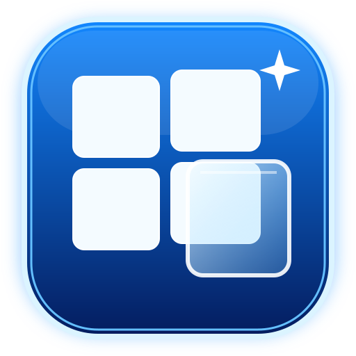

# Windows UI Transparency

Windows 11 のタスクバー背景や、対応ビルドでの時計・アイコン領域の透明度調整を試すデスクトップアプリです。UIは丸みのある青灰色のテーマ、操作フィードバック、カテゴリーごとのスクロール可能なポップアップ設定を備えています。

## アプリアイコン

アプリのアイコンは、青紫のガラス風フレームと半透明のウィンドウを組み合わせたベクターデザインです。`assets/windows-ui-transparency-icon.svg` が高解像度のマスター画像です。ビルド時に1024×1024 PNGと16〜256pxの複数サイズを含むWindows用 `.ico` を生成し、小さい画像を拡大せずにEXEへ埋め込みます。

## EXEの機能

- タスクバー背景: 透明 / ぼかし / アクリル風 / 標準に戻す
- 対応するWindowsビルドでは、時計・アプリアイコン領域の個別透明度を試行
- 設定保存とExplorer再起動後の再適用
- EXE版からWindowsサインイン時の自動起動を登録・解除
- 1024pxアイコンソースから複数サイズの `.ico` を生成し、単体 `WindowsUITransparency.exe` に埋め込み
- GitHub Actionsの成果物にはEXEファイルだけを格納（ZIPの中に別のZIPは入れない）

## EXEをダウンロード

1. GitHubリポジトリの [Actions](https://github.com/negitorojiamao-cell/windows-ui-transparency/actions) を開く
2. 最新の **Build Windows EXE** 実行を開く
3. 成功した実行の **Artifacts** から `WindowsUITransparency-EXE` をダウンロード
4. GitHubがダウンロード用に作るZIPを1回だけ展開し、中の `WindowsUITransparency.exe` を起動。ZIPの中に別のZIPはありません。

EXEにはアプリアイコンが埋め込まれます。未署名EXEのため、SmartScreenが警告を表示する場合があります。

## スタートアップ登録

EXEを起動し、**Windowsへのサインイン時に起動**にチェックを入れてください。ユーザー単位の `HKCU\\Software\\Microsoft\\Windows\\CurrentVersion\\Run` に登録するため、通常は管理者権限不要で、タスクマネージャーの「スタートアップ アプリ」に表示されます。チェックを外すと解除されます。

登録後にEXEを移動・削除すると起動できなくなるため、置き場所を決めてから登録してください。Pythonソースから起動した場合は誤ってPython自体を登録しないよう、スタートアップ設定を無効にしています。

## ソースから起動

WindowsにPython 3.10以降をインストールし、リポジトリ内で実行します。

    python tools/make_icon.py
    py -3 windows_ui_transparency.py

または `起動.bat` から起動できます。EXEはバッチファイルに依存せず、単体で実行できます。

## 時計などの個別透明化について

アプリはタスクバー配下に `TrayClockWClass`（時計）と `MSTaskListWClass`（アプリアイコン領域）が存在するか検出し、見つかった場合に限り不透明度変更を試します。アイコンは1個ずつではなく領域全体が対象です。Windows 11のビルドによっては共有XAML/DirectComposition描画のため個別ウィンドウが存在せず、この機能を利用できない場合があります。

## 制限

- スタートメニュー、通知センター、クイック設定、ウィジェットを一括で透明化する機能はありません。
- タスクバー背景効果には `SetWindowCompositionAttribute` という公開サポートが保証されないAPIを使用します。Windows更新で動作が変わる可能性があります。
- Windows 11のシステムUIすべてを一律に透明化するものではありません。

## 技術資料

- [Microsoft: SetWindowCompositionAttribute](https://learn.microsoft.com/en-us/windows/win32/dwm/setwindowcompositionattribute)
- [Microsoft: DWM overviews](https://learn.microsoft.com/en-us/windows/win32/dwm/dwm-overviews)
- [Microsoft: Customize the Windows 11 Taskbar](https://learn.microsoft.com/en-us/windows-hardware/customize/desktop/customize-the-taskbar)
